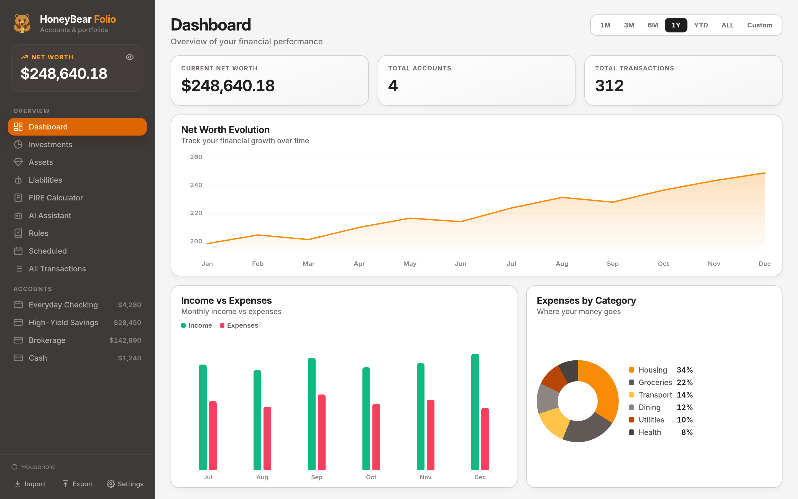
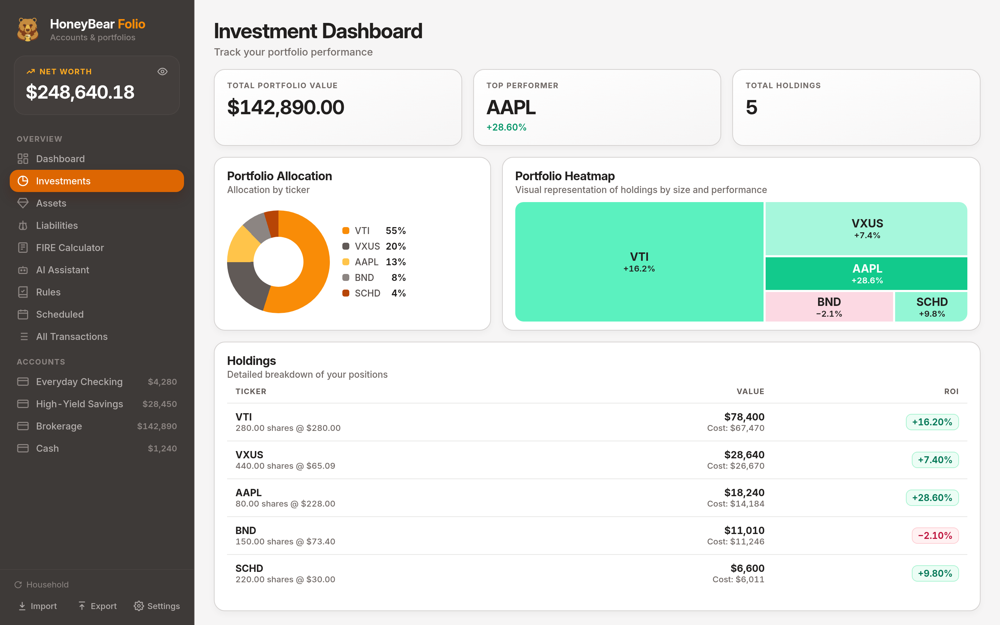
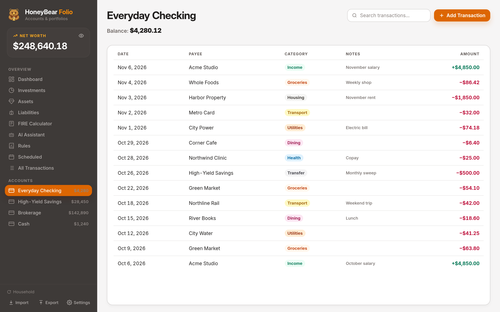

# HoneyBear Folio

<p align="center">
  
</p>

<p align="center">
  A local-first personal finance app for the desktop.<br />
  Accounts, investments, and net worth stay in a SQLite file on your machine.
</p>

<p align="center">
  <a href="https://github.com/HoneyBearFolio/HoneyBear-Folio/releases">Downloads</a>
  &nbsp;·&nbsp;
  <a href="https://honeybearfolio.github.io">Website</a>
  &nbsp;·&nbsp;
  <a href="LICENSE">AGPL-3.0</a>
</p>

<p align="center">
  
</p>

<p align="center"><sub>Figures in the screenshots are sample data.</sub></p>

## Features

**Dashboard.** Net worth over a range you choose, income against expenses, spending by category, how assets are split, and a cash-flow diagram. You can hide individual accounts when you want a narrower view.

**Investments.** Holdings, cost basis, and gain or loss. Quotes and daily prices come from Yahoo Finance and feed the allocation chart and the performance heatmap.

**Transactions.** Cash accounts, transfers between accounts, and brokerage trades. A buy or sell records the share leg and the matching cash leg. Search, edit, duplicate, and delete from the account.

**Scheduled transactions and rules.** Recurring items wait until you apply them. A rule matches a payee by text or by regular expression and fills in the category, account, notes, tags, and any other field you choose. Rules run while you type a transaction and again during import.

**Assets and liabilities.** Keep a value history for a home, a car, or anything else you own, and a balance history for mortgages, loans, and other debts. Both are included in net worth.

**FIRE calculator.** Starts from your balances, spending, and savings, then projects a target with a single path and a Monte Carlo range.

**Import and export.** Bring in CSV, Excel, or JSON. Map the columns, preview the rows, and let the importer create accounts it has not seen before. Send data back out as JSON, CSV, Excel, or a PDF report for a period you choose.

**Day to day.**

- Keep more than one database. Create a file, open an existing one, and switch from the sidebar.
- Accounts and transactions can use different currencies. Exchange rates come from Yahoo Finance, and any rate can be replaced with one you enter.
- Privacy mode masks amounts and leaves the currency symbol visible.
- The interface is available in English and Spanish.
- Choose light, dark, high contrast, ink, or follow the system, and scale the type size.
- An optional assistant uses [Ollama](https://ollama.com) on your computer. It can look up accounts, transactions, holdings, assets, and liabilities.

<p align="center">
  
</p>

<p align="center">
  
</p>

## Download

Installers are on the [releases](https://github.com/HoneyBearFolio/HoneyBear-Folio/releases) page for Windows, macOS, and Linux (`.deb`, `.rpm`, AppImage, and Flatpak). The running app can check that page for a newer version.

## Development

Prerequisites:

- [Bun](https://bun.sh) 1.3.6 or newer
- A stable [Rust](https://rustup.rs) toolchain
- Tauri’s system libraries for your OS

Ubuntu or Debian:

```bash
sudo apt-get update
sudo apt-get install -y libwebkit2gtk-4.1-dev libappindicator3-dev librsvg2-dev patchelf build-essential curl wget file libssl-dev
```

Fedora:

```bash
sudo dnf install webkit2gtk4.1-devel libappindicator-gtk3-devel librsvg2-devel openssl-devel curl wget file patchelf gcc pkg-config
```

Run the app:

```bash
cd app
bun install
bun run tauri dev
```

Build installers for the current platform:

```bash
cd app
bun run tauri build
```

Other scripts, run from `app/`:

| Command | Purpose |
| --- | --- |
| `bun run dev` | Start the Vite dev server on its own |
| `bun test` | Run the Vitest suite |
| `bun run coverage` | Run tests and fail under 80% line coverage |
| `bun run lint` | ESLint, with zero warnings allowed |
| `bun run typecheck` | TypeScript check (`tsc --noEmit`) |
| `bun run version:sync` | Copy the version from `package.json` into the Tauri config and `Cargo.toml` |

See [CONTRIBUTING.md](CONTRIBUTING.md) for layout, error-handling conventions, and the pull request checklist.

## Layout

- `app/` — React, Vite, and the Tauri shell
- `app/src/features/` — screens for the dashboard, accounts, investments, assets, liabilities, FIRE, rules, scheduled transactions, the assistant, and settings
- `app/src/api/tauri-client.ts` — typed calls into Rust
- `app/src-tauri/src/core/` — commands, SQLite, market data, import and export, and PDF reports

## Your data

The default database is `honeybear.db` inside the app data directory:

- Linux: `~/.local/share/com.honeybearfolio.honeybearfolio/honeybear.db` (or under `$XDG_DATA_HOME`)
- macOS: `~/Library/Application Support/com.honeybearfolio.honeybearfolio/honeybear.db`
- Windows: `%APPDATA%\com.honeybearfolio.honeybearfolio\honeybear.db`

The session screen can create or open a database somewhere else, and the sidebar shows which file is open. Copy that file before an import you may want to undo.

## Releases

Pushing a tag such as `v1.2.3` builds the installers. The release workflow writes that version into `app/package.json`, `app/src-tauri/tauri.conf.json`, and `app/src-tauri/Cargo.toml`.

## Contributing

Contributions are welcome. For a larger feature, open an issue first so the scope is settled before the code.

You can also [buy me a coffee](https://www.buymeacoffee.com/BernatBC).

## License

[GNU Affero General Public License v3.0](LICENSE) or later.
